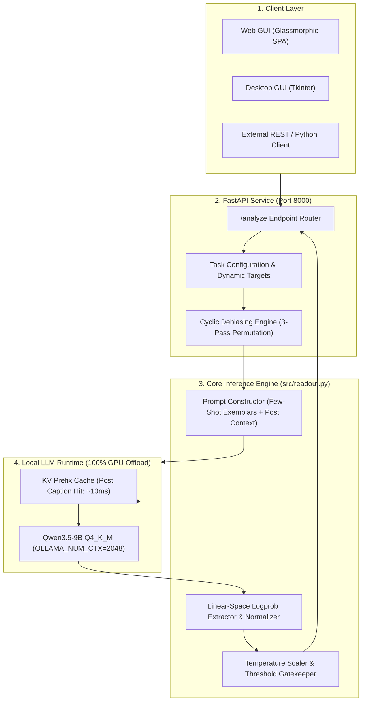

<div align="center">

# ⚡ Social Media Comment Judge

**High-Throughput, Calibrated Probability Engine for Social Media NLP**  
*Local LLM Inference · One-Token Logprob Readout · Cyclic Debiasing · Post-Context Prompt Caching*

[](https://opensource.org/licenses/MIT)
[](https://www.python.org/)
[](https://fastapi.tiangolo.com)
[](https://ollama.ai)
[](https://huggingface.co/unsloth/Qwen3.5-9B-GGUF)
[](tests/)

[Quickstart](#-quickstart) •
[Key Architecture](#-key-architecture) •
[Benchmarks](#-benchmarks--performance) •
[API Reference](#-api-reference) •
[GUIs](#-dual-gui-interface) •
[Debiasing & Calibration](#-mathematical-rigor)

</div>

---

## 📌 Overview

**Social Media Comment Judge** is a production-grade inference engine designed to classify multilingual social media comments (English, Hindi, Hinglish, emojis, political memes, and sarcasm) into calibrated sentiment, content moderation, stance, and custom user-defined tasks.

Traditional LLM classification pipelines generate full natural-language strings (e.g. *"The sentiment is positive because..."*), which suffer from high latency ($1.5\text{s} - 4\text{s}$ per comment), token hallucinations, and uncalibrated confidence scores. 

This engine implements **One-Token Logprob Letter Readout** on local quantized LLMs ([Qwen3.5-9B](https://huggingface.co/unsloth/Qwen3.5-9B-GGUF) / [DeepSeek-V4-Pro](https://huggingface.co/Jackrong/DeepSeek-V4-Pro-Qwen3.5-9B-MTP-GGUF)):
- **Sub-200ms latency** per task.
- **Root-level logprob extraction** with linear-space renormalization.
- **Cyclic Option-Order Debiasing** to eliminate LLM letter selection bias.
- **Platt Temperature Scaling** for well-calibrated confidence estimates ($ECE < 0.05$).
- **Post-Context KV Prompt Caching** allowing thousands of comments under a post to share pre-computed context at near-zero incremental cost.

---

## 🏗️ System Architecture



---

## ✨ Key Features

| Feature | Description |
| :--- | :--- |
| **⚡ One-Token Readout** | Extracts candidate letter probabilities directly from the model's logits at the first output position. No verbose string generation. |
| **🛡️ Cyclic Debiasing** | 3-pass cyclic permutation averaging eliminates the systemic positional bias of LLMs (frequently preferring letter `A`). |
| **🎯 Dynamic Stance Targeting** | Measures public support, opposition, or neutrality against any target entity, politician, brand, or policy on the fly. |
| **🧠 Post-Context Prompt Caching** | Feeds post captions/topics into the LLM prefix. Leverages llama.cpp KV-cache reuse across thousands of comments under the same post. |
| **🇮🇳 Multilingual Hinglish & Memes** | Few-shot exemplars tailored for Indian social media discourse: differentiates vulgar Hindi slurs from demographic hate speech, resolves Indian political memes (*"resign button"*, *"respect button"*), and detects sarcastic praise. |
| **📈 Platt Temperature Calibration** | Optimizes temperature $T$ on holdout calibration data via negative log-likelihood (NLL) minimization to deliver reliable confidence probabilities. |
| **🖥️ Dual User Interface** | Includes both a modern, reactive Web GUI (Tailwind CSS, glassmorphism) and a lightweight standalone Python Tkinter desktop GUI. |
| **🧩 Arbitrary Dynamic Tasks** | Pass custom questions with 2 to 8 options dynamically via API without modifying code or restarting the server. |

---

## 📊 Benchmarks & Performance

Measured on a consumer laptop GPU (**NVIDIA GeForce RTX 5050 Laptop GPU, 8 GB VRAM**, Windows 11):

### 1. Hardware Utilization & Latency
* **Model:** `unsloth/Qwen3.5-9B-GGUF:Q4_K_M` (5.29 GB GGUF)
* **VRAM Consumption:** **5.6 GB / 8.0 GB (100% GPU Offloaded, 0% CPU Spill)**
* **Context Window:** `num_ctx 2048` with `keep_alive -1`
* **Single-Token Readout Latency:** **$\sim 150 - 200\text{ ms}$** per task
* **3-Task Pipeline (Sentiment + Hate + Stance):** **$\sim 500 - 650\text{ ms}$** total per comment

### 2. High-Throughput Scaling (With Post-Context KV Caching)

| Comments Processed | Single-Token Readout Stream<br/>*(Exact Calibrated Probabilities)* | Bulk Chunked Batching<br/>*(10-15 comments per call)* |
| :--- | :--- | :--- |
| **1 comment** | **$\sim 0.6\text{ seconds}$** | $\sim 1.2\text{ seconds}$ |
| **10 comments** | **$\sim 5.0\text{ seconds}$** | $\sim 2.5\text{ seconds}$ |
| **100 comments** | **$\sim 50\text{ seconds}$** | $\sim 23\text{ seconds}$ |
| **1,000 comments** | **$\sim 8.5\text{ minutes}$** | $\sim 3.8\text{ minutes}$ |
| **Full Post (1,500 comments)** | **$\sim 12.5\text{ minutes}$** | $\sim 5.5\text{ minutes}$ |
| **Dataset (86,000 comments)** | **$\sim 12\text{ hours}$** *(single overnight pass)* | **$\sim 5.5\text{ hours}$** |

---

## 🚀 Quickstart

### Prerequisites
- Python 3.10, 3.11, or 3.12
- [Ollama](https://ollama.ai) installed and running locally
- NVIDIA GPU with $\ge 6\text{ GB}$ VRAM (or CPU fallback)

### 1. Clone & Install

```bash
git clone https://github.com/your-username/social-media-comment-judge.git
cd social-media-comment-judge

# Create virtual environment
python -m venv .venv
# Windows:
.venv\Scripts\activate
# Linux/macOS:
source .venv/bin/activate

# Install dependencies
pip install -r requirements.txt
```

### 2. Build the Ollama Model

Build the dedicated Qwen3.5-9B judge model with pre-baked context settings:

```bash
ollama create qwen3.5-judge -f Modelfile.qwen
```

*(Alternatively, for DeepSeek-V4-Pro: `ollama create comment-judge -f Modelfile`)*

### 3. Launch the Server & Web GUI

```bash
python run_server.py
```
* **Web UI:** Open [http://127.0.0.1:8000](http://127.0.0.1:8000) in your browser.
* **Interactive OpenAPI Docs:** Open [http://127.0.0.1:8000/docs](http://127.0.0.1:8000/docs).

### 4. Launch Desktop GUI (Optional)

```bash
python gui.py
```

---

## 📡 API Reference

### `POST /analyze`
Classifies a comment across built-in or custom tasks.

#### Request Body
```json
{
  "text": "Full support to the team, adivasi school repair is essential 🙌",
  "post_context": "Introducing our community welfare initiative for local schools.",
  "target": "Welfare Initiative",
  "tasks": ["sentiment", "hate", "support"],
  "debias": false
}
```

#### Response (`200 OK`)
```json
{
  "request_id": "e480cf20",
  "model": "qwen3.5-judge",
  "target": "Welfare Initiative",
  "post_context": "Introducing our community welfare initiative for local schools.",
  "debias_applied": false,
  "elapsed_ms": 612.4,
  "results": {
    "sentiment": {
      "label": "positive",
      "confidence": 0.9364,
      "probs": {
        "positive": 0.9364,
        "neutral": 0.0141,
        "negative": 0.0495
      },
      "needs_review": false
    },
    "hate": {
      "label": "neither",
      "confidence": 0.9971,
      "probs": {
        "hateful": 0.0019,
        "offensive but not hateful": 0.0009,
        "neither": 0.9971
      },
      "needs_review": false,
      "flag": false
    },
    "support": {
      "label": "supports",
      "confidence": 0.9142,
      "probs": {
        "supports": 0.9142,
        "opposes": 0.0125,
        "neither": 0.0733
      },
      "needs_review": false
    }
  }
}
```

#### Dynamic Custom Task Example
You can define ad-hoc classification questions with 2 to 8 options on the fly:
```json
{
  "text": "Is this product waterproof? Want to buy before monsoon.",
  "custom_tasks": {
    "intent": {
      "question": "What is the primary customer intent?",
      "options": ["pre-purchase inquiry", "complaint", "feedback", "spam"]
    }
  }
}
```

---

## 🖥️ Dual GUI Interface

### 1. Web Application (`src/static/index.html`)
The modern glassmorphic web dashboard served automatically by FastAPI at `http://127.0.0.1:8000`:
- **Real-Time Confidence Meters:** Animated probability bars for every option.
- **Sentiment Granularity Toggle:** Switch seamlessly between 3-class and 5-class fine-grained emotion detection.
- **Dynamic Target Field:** Type any political figure, organization, or issue for stance analysis.
- **🛡️ Cyclic Debiasing Switch:** Toggle 3-pass permutation averaging with one click.
- **Dynamic Task Builder:** Add arbitrary multi-choice questions visually.

### 2. Desktop Window (`gui.py`)
A fast, standalone Python Tkinter dark-mode application for offline workstations and local data labeling.

---

## 🔬 Mathematical Rigor

### 1. One-Token Logprob Normalization
For a task with $K$ candidate choices labeled by letters $\mathcal{L} = \{A, B, \dots\}$, Ollama returns the top-$M$ tokens and their log-probabilities $\log P(t_m)$ at the first generated position.

We sum the exponentiated probabilities for tokens matching each letter (including variations like `'A'` and `' A'`):
$$S_k = \sum_{t_m \in \text{tokens}(L_k)} \exp(\log P(t_m))$$
The probability distribution is then renormalized strictly over the valid options:
$$P(y = L_k \mid x) = \frac{S_k + \epsilon}{\sum_{j=1}^K (S_j + \epsilon)}$$

### 2. Cyclic Option-Order Debiasing
Autoregressive language models exhibit an inherent positional selection bias, often assigning higher probability to the first option (`A`) irrespective of content.

To eliminate this without fine-tuning, the engine rotates the options cyclically across $N = \min(3, K)$ passes:
$$\pi_s(i) = (i + s) \pmod K, \quad s \in \{0, 1, 2\}$$
The model evaluates each permutation $\pi_s$, and probabilities are mapped back to their canonical indices:
$$P_{\text{debiased}}(y = k \mid x) = \frac{1}{N} \sum_{s=0}^{N-1} P\left(y = \pi_s(k) \mid x, \pi_s\right)$$

### 3. Platt Temperature Scaling
Probabilities are calibrated against holdout validation sets by fitting a single temperature scalar $T$ that minimizes negative log-likelihood (NLL):
$$\hat{T} = \arg\min_{T > 0} -\frac{1}{M} \sum_{m=1}^M \log \left( \frac{P(y_m)^{1/T}}{\sum_j P(y_j)^{1/T}} \right)$$

---

## 🧪 Testing & Quality Assurance

The codebase includes comprehensive unit tests verifying probability renormalization, cyclic permutation mapping, temperature scaling, ECE computation, and API endpoints.

Run the test suite:
```bash
pytest -v
```

All 11 unit tests execute in $\sim 2\text{ seconds}$ without requiring GPU access.

---

## 📁 Repository Structure

```
.
├── .github/
│   └── workflows/
│       └── ci.yml               # GitHub Actions CI workflow
├── config/
│   ├── prompts.json             # Task definitions, options, few-shot exemplars
│   ├── temperatures.json        # Calibrated temperature scaling values
│   └── thresholds.json          # High-precision moderation decision thresholds
├── data/
│   ├── calib.csv                # 400 holdout calibration comments
│   ├── hard.csv                 # 100 challenging edge-case comments
│   └── test.csv                 # 800 benchmark test comments
├── docs/
│   └── label_guidelines.md      # Annotation guidelines for sentiment, hate, and stance
├── notebooks/
│   ├── 01_baseline.py           # Baseline evaluation scripts
│   ├── 02_calibration.py        # Temperature fitting scripts
│   └── 03_evaluation.py         # Full benchmark reporting
├── src/
│   ├── static/
│   │   └── index.html           # Modern glassmorphism Web GUI
│   ├── api.py                   # 24/7 FastAPI server
│   ├── calibrate.py             # Temperature scaling and ECE calculation
│   ├── evaluate.py              # Macro-F1, confusion matrix, latency benchmarks
│   ├── ingest.py                # Dataset ingestion & PII scrubbing pipeline
│   ├── label_assistant.py       # Active learning & assisted data labeling
│   └── readout.py               # Core one-token readout engine & debiasing
├── tests/
│   ├── test_api.py              # FastAPI endpoint tests
│   ├── test_calibration.py      # Calibration math & ECE tests
│   └── test_readout.py          # Logprob extraction & prompt tests
├── .gitignore                   # Enterprise gitignore (protects raw media & PII)
├── CONTRIBUTING.md              # Contribution guidelines
├── gui.py                       # Standalone Python Tkinter desktop GUI
├── LICENSE                      # MIT License
├── Modelfile.qwen               # Qwen3.5-9B Ollama model definition
├── pyproject.toml               # PEP 517/621 package configuration
├── README.md                    # Primary documentation
├── requirements.txt             # Pinned project dependencies
└── run_server.py                # Production server launcher
```

---

## 📄 License

This project is licensed under the **MIT License** — see the [LICENSE](LICENSE) file for details.

---

## 💡 Acknowledgements & References
* **Cygnet & Plumb:** Inspired by the one-token letter readout methodology pioneered by [blockbrain-ai/cygnet-recipe](https://github.com/blockbrain-ai/cygnet-recipe) and [crh225/plumb-4b](https://huggingface.co/crh225/plumb-4b).
* **Qwen Team & Alibaba Cloud:** For the state-of-the-art [Qwen2.5 / Qwen3.5](https://huggingface.co/Qwen) series of language models.
* **Ollama & llama.cpp:** For enabling ultra-fast local LLM inference and KV-cache prefix reuse on consumer hardware.
